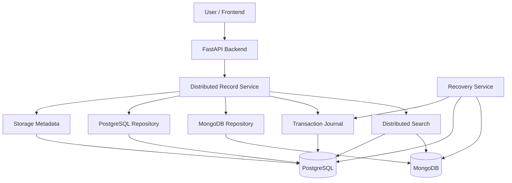

# Distributed SQL and NoSQL Data Management System

## 1. Project Overview

This project was developed for the **Data Intensive Systems** course. Its purpose is to demonstrate how SQL and NoSQL databases can work together in a distributed data management system.

The application uses two different database technologies to store and manage a sales dataset. Records are distributed between the databases, while users can retrieve, modify, and synchronize data through a centralized backend API.

The main objectives are:

- Integrate a relational SQL database and a document-oriented NoSQL database.
- Distribute the provided CSV dataset across both databases.
- Support searches across all records or within an individual database.
- Allow users to create, update, and delete records.
- Implement a replication protocol to maintain consistency between databases.

## 2. Technologies

| Component | Technology |
|---|---|
| Relational database | PostgreSQL |
| NoSQL database | MongoDB |
| Backend | Python, FastAPI |
| ORM and data access | SQLAlchemy, PyMongo |
| Data validation | Pydantic |
| Containerization | Docker, Docker Compose |
| API documentation | OpenAPI / Swagger UI |

## 3. Database Architecture and Data Distribution

The system uses PostgreSQL and MongoDB for different storage approaches.

**PostgreSQL (SQL)**
- Stores data using a normalized relational schema.
- Uses relationships between entities.
- Maintains the central `record_locations` table, which tracks where each record is stored and its current version.
- Acts as the authoritative source for storage metadata and transaction coordination.

**MongoDB (NoSQL)**
- Stores records as documents.
- Uses embedded entities to represent related information within each document.
- Maintains a document version to support synchronization and concurrency control.

### Dataset distribution

The dataset contains 30 records, divided into three groups:

| Storage location | Records | Description |
|---|---:|---|
| PostgreSQL only | 10 | Stored exclusively in PostgreSQL |
| MongoDB only | 10 | Stored exclusively in MongoDB |
| Both databases | 10 | Replicated across PostgreSQL and MongoDB |
| **Total logical records** | **30** | **100% of the dataset** |

Records stored in both databases represent the same logical data, not separate records. When searching across all databases, duplicate records are eliminated.

## 4. Replication and Consistency Protocol

The system implements an application-level distributed replication protocol.

Each record has a storage location and a version number. The backend uses this information to determine which database must be accessed or modified.

The supported storage configurations are:

- `POSTGRESQL`: PostgreSQL is the only storage location.
- `MONGODB`: MongoDB is the only storage location.
- `BOTH`: Both databases contain the same logical record.

### Update and replication workflow

When a record is modified:

1. The backend checks the current record version and locks the relevant metadata.
2. A persistent transaction journal entry is created in PostgreSQL.
3. The required changes are applied to the relevant database or databases.
4. Shared entities are updated consistently across affected records.
5. Record versions and storage metadata are updated.
6. The operation is marked as committed.

The protocol includes:

- **Optimistic concurrency control:** prevents updates based on outdated versions.
- **Atomicity through compensation:** if one database operation fails, previously applied changes are restored where possible.
- **Persistent transaction journal:** records the state of distributed operations.
- **Crash recovery:** pending operations are examined during application startup and either compensated or finalized.
- **Consistency checks:** record versions and storage metadata are kept synchronized.

This provides logical transaction coordination across PostgreSQL and MongoDB without relying on a native distributed ACID transaction spanning both database engines.

## 5. System Architecture



The backend acts as the coordination layer between the two databases. Repositories handle database-specific operations, while the distributed service manages storage decisions, searches, modifications, and replication.

The recovery service processes unfinished operations when the application starts.

## 6. Main Functionalities

The backend provides the following functionality:

- **Create:** insert records into PostgreSQL, MongoDB, or both.
- **Read:** retrieve individual records using their identifiers.
- **Search:** retrieve all records or search within a specific database.
- **Update:** modify records while maintaining version consistency.
- **Delete:** remove records from their corresponding storage locations.
- **Replication:** propagate changes to all relevant database copies.
- **Recovery:** restore or finalize interrupted distributed operations.

The search functionality supports three storage scopes:

| Scope | Expected records |
|---|---:|
| `ALL` | 30 |
| `POSTGRESQL` | 20 |
| `MONGODB` | 20 |

The `ALL` search returns 30 unique logical records, avoiding duplicates for records stored in both databases.

## 7. Running the Project

The application uses Docker Compose to manage its services.

### Requirements

- Docker
- Docker Compose

### Setup

Clone the repository and navigate to the project directory.

Create the environment configuration:

```bash
cp .env.example .env
```

Configure the environment variables in `.env` according to the provided configuration template.

Build and start the services:

```bash
docker compose --env-file .env up --build -d
```

Check running containers:

```bash
docker compose ps
```

To stop the application:

```bash
docker compose down
```

### API Documentation

Once the backend is running, the interactive API documentation is available at:

```text
http://localhost:8000/docs
```

The API base path is:

```text
/api/records
```

It supports the main CRUD operations through HTTP methods such as GET, POST, PUT, and DELETE.

## 8. Evaluation Criteria

| Course evaluation criterion | Project implementation |
|---|---|
| Correct database types | PostgreSQL and MongoDB |
| Working program | Dockerized backend and REST API |
| Data modification | Distributed CREATE, UPDATE, and DELETE |
| Data search | Global and database-specific search |
| Replication functionality | Distributed writes, versioning, transaction journal, and crash recovery |

## 9. Project Scope

This project focuses on the integration of relational and document-oriented databases, distributed data access, and replication consistency.

The backend implements the core data operations and replication protocol. The frontend is the client interface intended to expose these operations to users.